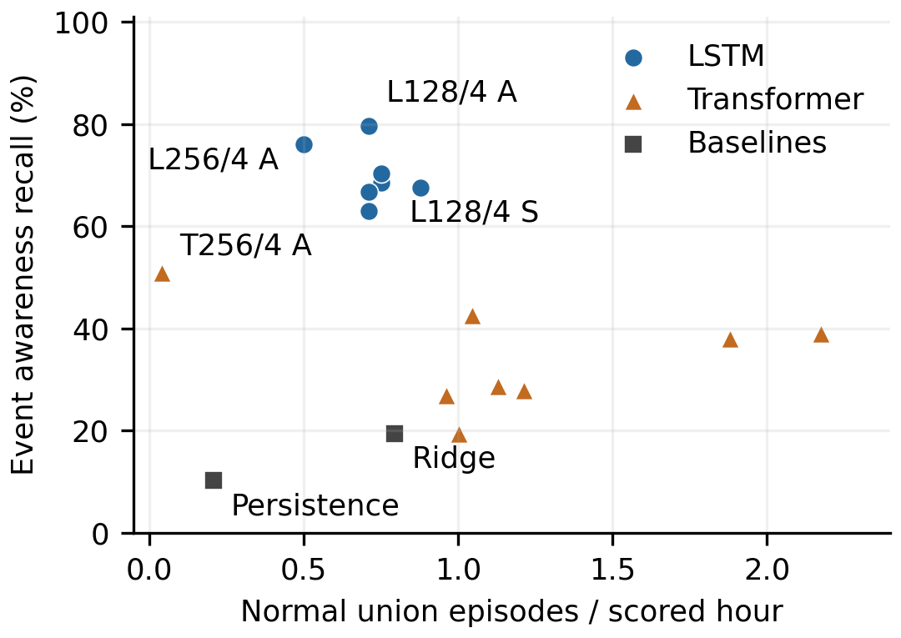
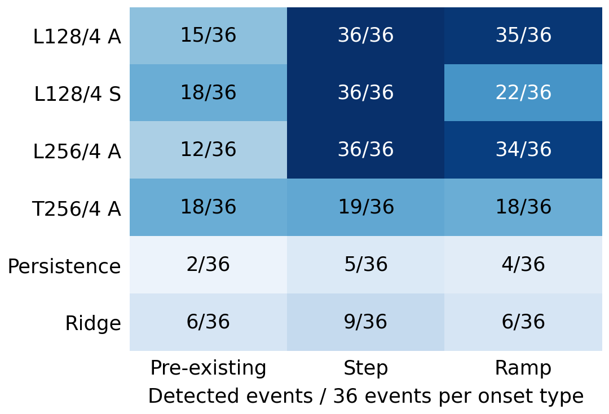
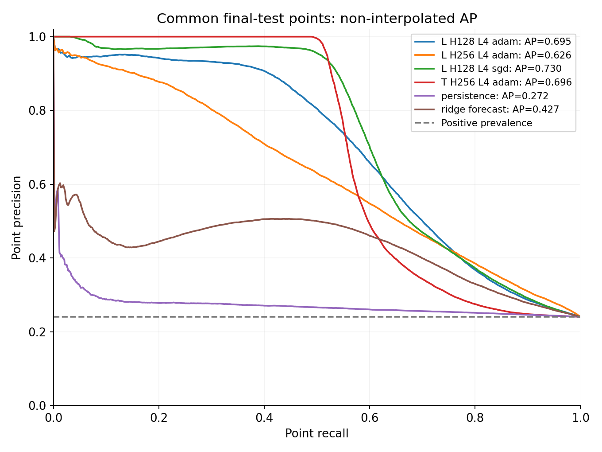

# X500 최종 평가 결과

2026-11-04 01:08 KST에 완료된 `attempt-02` 평가와 2026-11-04 사후 검산 결과다. 신경망 16종과 기준 모델 2종을 동일한 최종 324run에 평가했다. 학습 seed는 0이며 새 학습·추론·보정 없이 보존 결과를 배포한다.

정상 216run(독립 정상 108 + paired 대조 108), 이상 108run·108사건이다. 정상 scored 노출은 약 23.9234시간이고 모델별 공통 판정시점은 129,231개다. [수집·품질 결과](../../../Data/results/final-test-20261103/README.md)에서 구성과 재시도 이력을 확인할 수 있다.

## 전체 모델 비교

| 모델 | 탐지/108 | 사건 Recall | 사건 FNR | 시점 AP | 정상 경보/시간 |
|---|---:|---:|---:|---:|---:|
| lstm_h64_l2_sgd_s0 | 68 | 62.96% | 37.04% | 0.70477 | 0.7106 |
| lstm_h64_l2_adam_s0 | 74 | 68.52% | 31.48% | 0.68508 | 0.7524 |
| transformer_h64_l2_sgd_s0 | 29 | 26.85% | 73.15% | 0.55382 | 0.9614 |
| transformer_h64_l2_adam_s0 | 21 | 19.44% | 80.56% | 0.62606 | 1.0032 |
| lstm_h128_l2_sgd_s0 | 68 | 62.96% | 37.04% | 0.71106 | 0.7106 |
| lstm_h128_l2_adam_s0 | 72 | 66.67% | 33.33% | 0.64183 | 0.7106 |
| transformer_h128_l2_sgd_s0 | 30 | 27.78% | 72.22% | 0.52735 | 1.2122 |
| transformer_h128_l2_adam_s0 | 42 | 38.89% | 61.11% | 0.64910 | 2.1736 |
| lstm_h128_l4_sgd_s0 | 76 | 70.37% | 29.63% | 0.72965 | 0.7524 |
| lstm_h128_l4_adam_s0 | 86 | 79.63% | 20.37% | 0.69452 | 0.7106 |
| transformer_h128_l4_sgd_s0 | 46 | 42.59% | 57.41% | 0.66138 | 1.0450 |
| transformer_h128_l4_adam_s0 | 41 | 37.96% | 62.04% | 0.66523 | 1.8810 |
| lstm_h256_l4_sgd_s0 | 73 | 67.59% | 32.41% | 0.72071 | 0.8778 |
| lstm_h256_l4_adam_s0 | 82 | 75.93% | 24.07% | 0.62561 | 0.5016 |
| transformer_h256_l4_sgd_s0 | 31 | 28.70% | 71.30% | 0.64159 | 1.1286 |
| transformer_h256_l4_adam_s0 | 55 | 50.93% | 49.07% | 0.69620 | 0.0418 |
| persistence | 11 | 10.19% | 89.81% | 0.27242 | 0.2090 |
| ridge_forecast | 21 | 19.44% | 80.56% | 0.42669 | 0.7942 |

[전체 CSV](tables/all18_results.csv) · [고장 유형](tables/scenario_results.csv) · [발생 방식·탐지 지연](tables/onset_results.csv) · [운항 조건](tables/condition_results.csv)



## 해석 범위

- 사건 Recall은 이상 진행 중 경보가 한 번 활성화되는 `awareness` 기준이다. 최대 허용 탐지 지연은 설정하지 않았다. 고장 원인 분류 정확도나 시점 Recall과는 다른 지표다.
- 시점 AP는 최종 평가 이후 계산한 비보간 Average Precision이다. 두 도메인의 EWMA를 각 동결 high로 나눈 값 중 최댓값을 사용하며, 사다리꼴 PR-AUC가 아니다. AP 추가 계산으로 임계값을 다시 맞추지 않았다.
- LSTM 128×4 Adam은 사건 Recall 86/108로 가장 높지만 기존 열화는 15/36이다. 그중 8건은 비행 종료 경계 부근이므로 조기 건강진단 성공으로 확대하지 않는다. 기존 배터리 열화는 2/18이며 두 건 모두 종료 경계에 해당한다.
- LSTM 128×4 SGD는 AP가 가장 높다. 전체 표는 결과를 본 뒤 특정 모델만 골라 보고하는 것을 피하기 위해 18종을 모두 포함한다.
- 동일 비행 안의 겹치는 창과 paired 정상–이상은 독립 표본이 아니다. 단일 학습 seed·시뮬레이션 결과이며 실기체 일반화나 seed 간 변동은 검증하지 않았다.
- 배치 계산시간은 전처리를 제외한 측정이다. 온라인 종단 지연으로 해석하지 않는다. 탐지 지연 분포는 탐지된 사건만의 값이므로 미탐 수와 함께 읽는다.



발생 방식 그림의 6개 설정은 사후 설명용 선택이며, 전체 18설정 결과는 `tables/onset_results.csv`에 있다.



## 포함 자료

| 경로 | 내용 |
|---|---|
| `evaluation/` | 완료·반납 기록, 고정 protocol, run별 계보, 평가 보고서, PR 곡선 |
| `evaluation/final-results.tar.gz` | 원본 평가 8파일. 약 29.8MB의 상세 `evaluation/metrics.json` 포함 |
| `tables/` | 18모델 비교, 조건·고장·지연·예측 오차, 학습 비용, 배치 계산시간 |
| `figures/` | 모델 비교·발생 방식·PR 그래프와 일부 PDF 원본 |
| `models/<model_id>/` | 보존 학습 설정·손실 이력·선택 epoch·고정 보정값. 가중치는 포함하지 않음 |
| `provenance/` | 당시 실행 소스 압축본·소스 해시와 기존 독립 검산 기록 |
| `manifest.json` | 배포 파일의 원본 경로·SHA-256·크기 |

원본 JSON의 절대 경로·job ID·상태는 당시 실행 증거다. `report.json`의 평가 직후 상태와 `completion.json`의 반납 완료 상태는 기록 시점이 다르다. 최종 완료 여부는 `completion.json`을 기준으로 한다.

이번 배포에서 보존 분석의 78개 원본 해시, 압축 평가 8파일의 내용 일치, 18모델의 사건 수·탐지 수·정상 경보율을 검산했다. 가중치·checkpoint·원시 비행 데이터·전체 예측/판정 로그·87MB 점수 추출본은 포함하지 않는다. 원자료 없이 모델 forward 또는 AP를 완전히 재현할 수 있는 패키지는 아니다. 기존 AP 검산 기록은 `provenance/ranking-verification.json`에 있으며 검산 대상 점수 추출본의 해시를 보존한다.

```bash
mkdir -p /tmp/irion-final-results
tar -xzf evaluation/final-results.tar.gz -C /tmp/irion-final-results
sha256sum /tmp/irion-final-results/evaluation/metrics.json
```

출력 해시를 `evaluation/completion.json`의 `metrics_sha256`과 비교한다.
